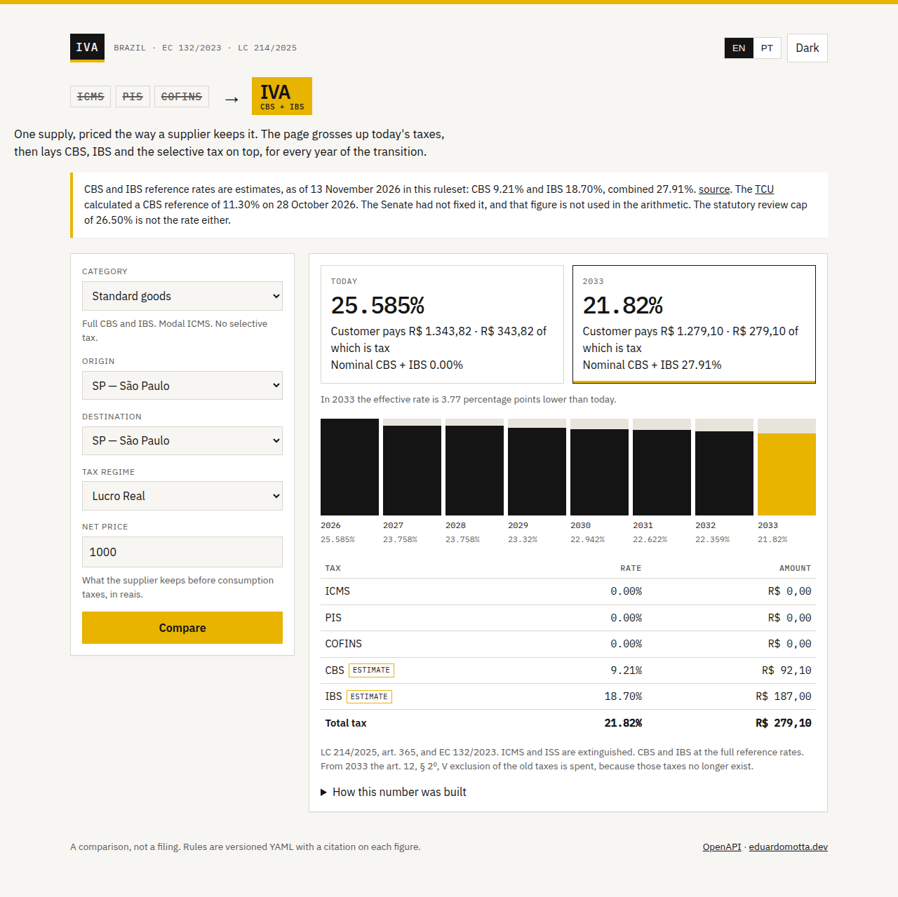
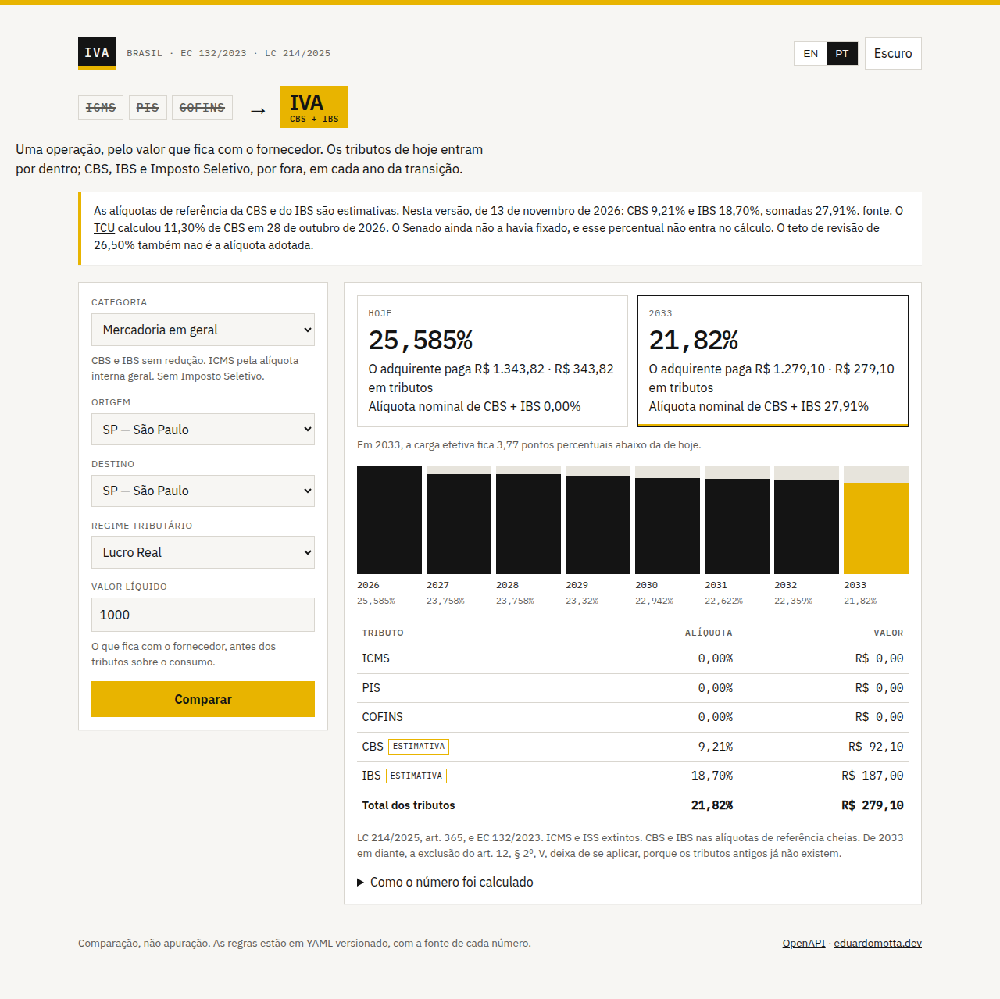
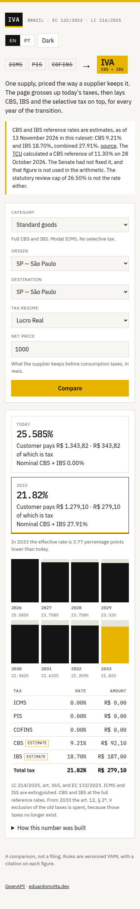
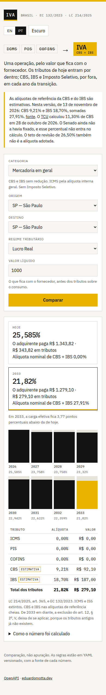
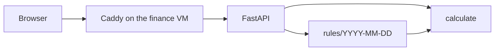
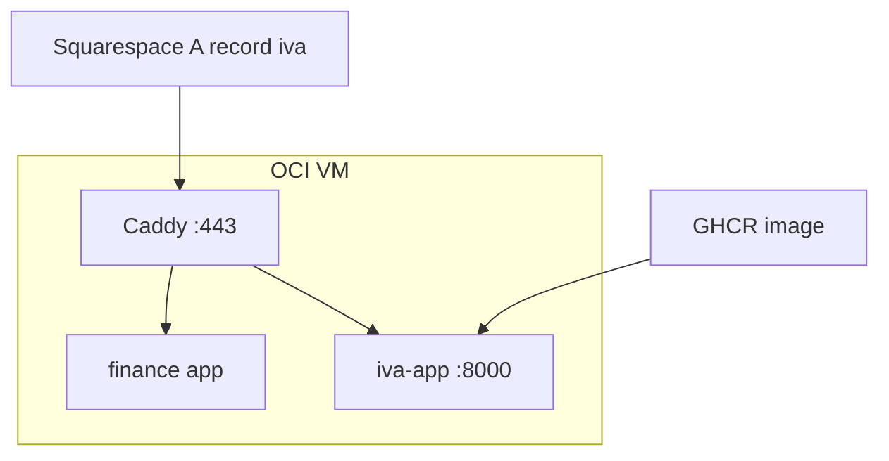

# IVA transition

A small calculator for Brazil's consumption-tax reform. It compares the taxes on one supply today — ICMS, PIS, COFINS, and IPI where a ruleset actually sets a rate — with CBS, IBS and the Imposto Seletivo, for every year from 2026 to 2033.

It is public at [iva.eduardomotta.dev](https://iva.eduardomotta.dev). The page and the API are the same origin. OpenAPI is at `/docs`.

Eduardo de Moraes, a tax lawyer who now works as a senior backend engineer, keeps the rates in versioned YAML and the arithmetic in a pure function. The point of the split is that a hiring manager can read the rule, and a later job can rerun it, without either one living inside a view.

## The page

English is the default. Portuguese is a toggle, and so is a dark theme. The heading is the comparison: ICMS, PIS and COFINS struck through, then IVA, which is CBS plus IBS. The yellow note is the estimate disclosure: the date, the pair of rates the arithmetic uses, and the TCU figure it does not use.

Standard goods, São Paulo to São Paulo, Lucro Real, R$ 1,000 net.









## What the reform does

[Constitutional Amendment 132/2023](https://www.planalto.gov.br/ccivil_03/constituicao/emendas/emc/emc132.htm) replaces five consumption taxes with two value-added taxes and a selective tax:

| Today | From the reform |
| --- | --- |
| PIS and COFINS (federal) | CBS, federal |
| ICMS (state) and ISS (municipal) | IBS, shared by states and municipalities |
| IPI, except a residue for the Manaus Free Zone | mostly extinguished in 2027 |
| — | Imposto Seletivo, on listed goods and services, from 2027 |

The replacement is a transition, not a flip. Complementary Law [214/2025](https://www.planalto.gov.br/ccivil_03/leis/lcp/lcp214.htm) sets the test rates and the phase-out.

| Year | What the statute does |
| --- | --- |
| 2026 | CBS 0.9% and state IBS 0.1%. Offset against PIS/COFINS, or waived if the accessory obligations are met. No extra burden. PIS, COFINS, ICMS and ISS stay. |
| 2027–2028 | PIS, COFINS and IPI end. CBS is the reference rate minus 0.1 percentage point. IBS is 0.05% state plus 0.05% municipal. The selective tax starts. ICMS and ISS stay at full rate. |
| 2029–2032 | ICMS and ISS fall to 90%, 80%, 70%, then 60% of the rate in force on 31 December 2028. IBS is phased in against that loss. CBS is at its reference rate. |
| 2033 | ICMS and ISS are gone. CBS and IBS are at their reference rates. |

The Senate had not fixed the CBS reference rate when this ruleset was written (13 November 2026). The page says so, in the yellow note, and it shows the date.

## What you can ask it

A category (not an NCM or NBS code yet), an origin state, a destination state, Lucro Real or Lucro Presumido, and a price. Simples Nacional is rejected on purpose: the unified schedule is a different table, and the 2026 test rates do not apply to it.

The price is what the supplier keeps before consumption taxes.

- ICMS, ISS, PIS and COFINS are inside the price. The invoice is grossed up so the supplier still keeps that amount. PIS and COFINS are charged on the invoice after ICMS and ISS are taken out (STF Topic 69, and Topic 118 for ISS).
- CBS and IBS do not tax themselves, and through 2032 they also ignore ICMS, ISS, PIS and COFINS ([LC 214/2025, art. 12, § 2º](https://www.planalto.gov.br/ccivil_03/leis/lcp/lcp214.htm)). On this price basis their base is the net price, so they are added on top.
- An interstate sale of goods to a final consumer bears the destination state's modal ICMS. The origin keeps the interstate rate from [Senate Resolution 22/1989](https://www.planalto.gov.br/ccivil_03/congresso/rsf/rsf22-89.htm) (7% or 12%). The destination keeps the difference, the DIFAL. The 4% rate for imported goods is not applied.

The number on the card is the effective rate: tax divided by what the customer pays. A nominal 27.91% charged on top of the price is not 27.91% of the price. Both figures are on the page.

This is the tax debited on one supply. It is not the net burden of a firm that credits tax on its inputs, under the old non-cumulative PIS/COFINS or under the new VAT.

## Where the numbers come from

`rules/2026-11-13/` is the ruleset. Each rate has a citation. The directory name is the version, and it matches `as_of` in `manifest.yaml`.

Two CBS figures were public in early November 2026, and they are not the same number:

- The Comitê Gestor do IBS working estimate, reported by [Senado Notícias on 26 October 2026](https://www12.senado.leg.br/noticias/materias/2026/10/26/reforma-tributaria-aliquota-da-cbs-avanca-nesta-semana) without official status: **CBS 9.21% and IBS 18.70%**, combined 27.91%. This is the pair the arithmetic uses, because it is a pair.
- The [TCU calculation of 28 October 2026](https://portal.tcu.gov.br/imprensa/noticias/tcu-calcula-aliquota-de-referencia-de-113-para-novo-tributo-sobre-consumo): a CBS reference of **11.3%**, sent to the Senate. The Senate had not fixed it. There is no IBS rate beside it. It is shown in the note and **not used in the arithmetic**.

The 26.5% figure in the statute is a review cap ([LC 214/2025, art. 475, § 11](https://www.planalto.gov.br/ccivil_03/leis/lcp/lcp214.htm)), not the rate.

Selective-tax rates for 2027 come from [Provisional Measure 1.399 of 4 November 2026](https://www.planalto.gov.br/ccivil_03/_ato2023-2026/2026/mpv/mpv1399.htm). Later years keep that rate and are marked as a holding assumption. The statute still requires an escalation for drinks and tobacco from 2029 to 2033, and that escalation has no published number.

Modal ICMS rates are the general rate in each state's statute, with the poverty-fund surcharge only where it is part of that general rule (Rio de Janeiro and Sergipe). A product rate, a fuel rate, or a municipal ISS table is a later version.

Adding a ruleset is a new directory. The loader takes the latest name, or `RULES_VERSION`.

## How the code is shaped



`calculate` in `app/engine/calculate.py` reads a request and a `RuleSet` and returns a result. It does not touch the clock, the disk, or the network. The HTTP layer in `app/api.py` only translates status codes. The tests call `calculate` directly.

A batch rerun, when it exists, should be an OCI Queue consumer. Not Kafka. The message shape is already `RecalculationCommand` in `app/engine/recalculate.py`: the same request, plus the rules version the job was priced with. The worker calls `apply`, which calls `calculate`. v1 does not publish or consume anything.


On the VM the finance Caddy keeps ports 80 and 443. This service is a second Compose project. Caddy reaches it by name on a shared Docker network. Details, including the Squarespace record and the fact that a finance deploy rewrites its own Caddyfile, are in [docs/deploy-oci.md](docs/deploy-oci.md).



## Run it locally

Python 3.12, then:

```bash
uv sync --extra dev
uv run ruff check app scripts
uv run ruff format --check app scripts
uv run pytest
uv run fastapi dev app/main.py
```

The dev server is at `http://127.0.0.1:8000`. `/docs` is the OpenAPI UI.

Docker, from a checkout that already has `uv.lock`:

```bash
docker compose up --build
```

That publishes `127.0.0.1:8000` only. It does not start Caddy and it does not need a database.

## Tests

`app/tests` covers the gross-up identity (the customer price minus the tax is the net price, in every year), the interstate split, the 2026 offset, the 2027 rate cut, the 2029–2033 phase-out, the 60% and 30% reductions, the selective-tax rates, the Simples refusal, the YAML citations, and the batch command. A ruleset that drops a citation or breaks `2026` through `2033` fails at load.

## Roadmap

- **Batch recalculation on OCI Queue.** The command and the pure function are in place. A worker would pull messages, call `apply`, and store results. No broker is wired up now, and it should not be Kafka.
- **NCM and NBS.** Categories are illustrative. A real classification table replaces them without changing `calculate`'s contract.
- **Simples Nacional**, from Complementary Law 123/2006, including the rule that the 2026 test rates do not apply.
- **Credits.** A chain of supplies, so the figure can be the net VAT instead of the debit on one sale.
- **The Manaus IPI residue**, and selective-tax escalation once a number is published for 2029–2033.
- **Municipal ISS**, in place of the 5% scenario rate.
